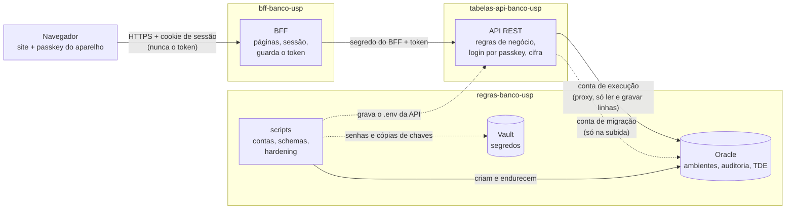

# regras-banco-usp 🏯

Regras de segurança do banco de dados Oracle da Kawashi Sistemas: hardening, ambientes, RBAC por
proxy, auditoria (SIEM) e Vault, provados por testes automatizados. Projeto da pós-graduação na
USP. É um dos três repositórios do projeto (ver a seção abaixo): as tabelas de negócio e a API ficam em
`tabelas-api-banco-usp`, e o site em `bff-banco-usp`.

## Os três repositórios do projeto

O sistema é dividido em três repositórios, um para cada camada. Cada um só precisa conhecer o
vizinho pelo que está descrito aqui; os detalhes ficam no README de cada um.

| Repositório | É responsável por | Não faz |
|---|---|---|
| [`regras-banco-usp`](https://github.com/caioteixeir4/regras-banco-usp) | O **banco Oracle e o Vault**: hardening, ambientes, contas e perfis (RBAC por proxy), auditoria, criptografia em disco (TDE) e na rede, e os schemas que a API não pode controlar (log, login e sessão). Define **quem entra no banco e o que cada conta pode fazer**. | Tabelas de negócio, API, site |
| [`tabelas-api-banco-usp`](https://github.com/caioteixeir4/tabelas-api-banco-usp) | As **tabelas de negócio** (empresa, filial, pessoa, contato, endereço) e a **API REST**: regras de negócio, cifra dos dados pessoais, login por passkey e emissão do token. Define **o que existe dentro dos schemas e como se usa**. | Contas do banco, tela; não atende o navegador |
| [`bff-banco-usp`](https://github.com/caioteixeir4/bff-banco-usp) | O **site** e o servidor dele (BFF): as páginas, o cookie de sessão e a guarda do token, que nunca chega ao navegador. Repassa à API só o que o site usa. | Regra de negócio, acesso ao banco |


Como se encaixam: `navegador → bff-banco-usp → tabelas-api-banco-usp → Oracle`, com o banco, os
schemas protegidos e o Vault montados pelo `regras-banco-usp`. O que liga cada par:

- **regras ↔ API**: o `create-api-account.ps1` (regras) cria as contas de banco da API (e, com
  `-OutEnvFile`, grava o `.env` dela); as tabelas de log, login e sessão são criadas pelas regras e só usadas pela API.
- **API ↔ BFF**: um segredo compartilhado (`BFF_SEGREDO`, gerado pelo
  `gerar-segredo-do-bff.ps1` da API nos dois `.env`). Sem ele a API não atende ninguém.
## 🧭 Escopo deste repositório

Aqui ficam as **regras do banco de dados** da Kawashi: hardening, ambientes de ciclo de vida,
RBAC por proxy, auditoria/SIEM, onboarding via Vault e a suíte de testes que prova tudo isso.
Este repositório **não** é o lugar das tabelas de negócio, da API nem do site: as tabelas e a API
ficam no `tabelas-api-banco-usp`, que roda sobre as regras daqui, e o site no `bff-banco-usp`.

- **Tabelas que ficam aqui** (só as essenciais): as 4 de controle de segurança em
  [`03_dynamic_tables.sql`](infra/oracle-init/03_dynamic_tables.sql) (`KAWASHI_ALLOWED_IPS`,
  `KAWASHI_FORBIDDEN_TOOLS`, `KAWASHI_SECURITY_LOG` e o fallback) e as **tabelas de log da
  aplicação** (`LOG_ALTERACAO`, `LOG_ACESSO` e a de controle `LOG_CADEIA`), uma cópia por ambiente no
  schema `KAWASHI_ENV_<AMBIENTE>_LOG`, em
  [`11_schema_log.sql`](infra/oracle-init/11_schema_log.sql). Elas ficam aqui, e não no repositório
  da API, para a API não ser dona delas: quem é dono de uma tabela consegue apagar as linhas.
- **O que fica no `tabelas-api-banco-usp`:** as tabelas de cadastro (`EMPRESA`, `FILIAL`, `PESSOA`,
  `CONTATO`, `ENDERECO`), as futuras tabelas de login e a API do banco.
- **Nada foi descartado.** A tag git `dominio-completo-pre-separacao` (commit `cadb773`) guarda o
  repositório exatamente como estava antes da separação, com os dois SQL de domínio e as docs
  completas.
  Ver [`arquitetura.md`, seção 2.2](infra/docs/arquitetura.md) e o item 20 de
  [`bugs-primeiro-teste.md`](infra/docs/bugs-primeiro-teste.md).
- Criar uma conta de banco (desenvolvedor ou API) não depende de nenhuma tabela de negócio: a
  identidade vive no dicionário do Oracle e a senha no Vault.

## 🚀 Arquitetura Geral
O projeto utiliza um modelo de defesa em camadas (Defense in Depth) para proteger
ativos de dados críticos. Para diagramas (containers/rede, ambientes de ciclo de vida e o
fluxo de onboarding via Vault), veja [`infra/docs/arquitetura.md`](infra/docs/arquitetura.md).

Para um resumo visual de uma página (Docker, Oracle, regras, ambientes, tabelas, scripts, testes e
pendências), abra [`infra/docs/resumo-visual.html`](infra/docs/resumo-visual.html) no navegador. Os
diagramas carregam o Mermaid pela internet.

## ▶️ Como subir o ambiente (primeira vez)

1. Copie `infra/.env.example` para `infra/.env` e preencha com valores reais (senhas fortes,
   sem `$` nem `#` — ver comentários do próprio arquivo).
2. `docker compose up` dentro de `infra/` — aguarde o container `kawashi-oracle` ficar
   `healthy` (`docker ps`), pode levar alguns minutos no primeiro boot.
3. Rode `infra/scripts/verify-environment.ps1` — confere se sobrou algum objeto `KAWASHI_*`
   inválido (PL/SQL com erro de compilação) e se os jobs agendados estão ativos, depois do
   bootstrap `01` a `17` (muito PL/SQL aqui nunca tinha rodado contra um Oracle de verdade).
4. Rode `infra/scripts/vault-init.ps1` — o Vault sobe "vazio" toda vez (modo dev), esse
   script configura o engine de segredos, o login por usuário/senha (pessoas) e o AppRole (aplicações).
5. Para dar acesso a alguém (inclusive você mesmo, se quiser um perfil além do `ENGINEER_USER`),
   use `infra/scripts/create-team-member.ps1` — ver [`infra/docs/criar-novo-usuario.md`](infra/docs/criar-novo-usuario.md).
6. (Opcional, mas recomendado) Rode a suíte de testes automatizados —
   `infra/tests/Run-AllTests.ps1` — ver [`infra/tests/README.md`](infra/tests/README.md).

Todo este fluxo já foi validado ponta a ponta contra um Oracle/Vault reais — 15 bugs foram
encontrados e corrigidos nesse processo. Detalhes de cada um (sintoma, causa raiz, correção)
em [`infra/docs/bugs-primeiro-teste.md`](infra/docs/bugs-primeiro-teste.md).

## ✅ O que já está implementado

### Banco de dados e hardening (bootstrap automático)
Tudo abaixo roda sozinho na primeira inicialização do container Oracle, via os scripts
numerados em [`infra/oracle-init/`](infra/oracle-init/) (`01` a `13` — os comentários de cada
arquivo explicam o "porquê" de cada peça, não só o "o quê"):

- Tablespaces separadas para dados de negócio, logs de auditoria e cada ambiente de ciclo
  de vida, todas com `MAXSIZE` (nunca crescimento ilimitado) — `01`, `09`.
- Política de senha (12+ caracteres, maiúscula/minúscula/número/especial, sem o username) +
  profile de segurança (bloqueio por tentativas, expiração a cada 90 dias, histórico de
  reuso, idle time, limite de sessões — com `RESOURCE_LIMIT=TRUE` habilitado, sem o qual boa
  parte desses limites de sessão seriam ignorados pelo Oracle) — `02_global_hardening.sql`.
  Hardening mínimo (bloqueio por tentativa + política de senha) também aplicado ao profile
  `DEFAULT`, como rede de segurança para contas futuras criadas sem profile explícito.
- Unified Auditing nativo do Oracle para `CREATE/ALTER/DROP USER`, `GRANT/REVOKE`,
  `LOGON/LOGOFF` — `02_global_hardening.sql` — com purga automática configurada
  (`DBMS_AUDIT_MGMT`) para não crescer indefinidamente no `SYSAUX` — `10_advanced_hardening.sql`.
- Proteção contra força bruta na camada de protocolo (`SEC_MAX_FAILED_LOGIN_ATTEMPTS`),
  complementar ao bloqueio de conta por tentativa — `10_advanced_hardening.sql`.
- Pacotes de rede/arquivo/Java historicamente usados em ataques via SQL Injection
  (`UTL_HTTP`, `UTL_TCP`, `UTL_SMTP`, `UTL_INADDR`, `UTL_FILE`, `DBMS_JAVA`) tiveram o
  `EXECUTE` revogado de `PUBLIC` — `10_advanced_hardening.sql`.
- Trilha de auditoria própria (`KAWASHI_SECURITY_LOG` + tabela de fallback), alimentada por
  triggers de logon, logoff, DDL e concessão de privilégio — `03`, `04`, `05`.
- Regras contextuais de logon: whitelist de IP, janela de horário, blacklist de ferramentas
  cliente, bloqueio de contas de SO inseguras (`ROOT`/`ADMINISTRATOR`/`GUEST`) — `05`. As
  regras de IP e horário são fail-open em dev (só registram, não bloqueiam), com `TODO` no
  próprio código para travar quando o time/infraestrutura de produção estiver definida.
- Jobs agendados: purge de logs com mais de 90 dias, rebuild semanal de índices, e trava
  automática de contas inativas há mais de 90 dias (protegendo `SPRING_APP_USER` e
  `ENGINEER_USER` de serem trancadas por engano) — `07_maintenance_jobs.sql`.
- Least privilege: usuário de aplicação (`SPRING_APP_USER`/`KAWASHI_SPRING_USER`) sem
  privilégio de tablespace ilimitada, contas nativas de risco (`SCOTT`, `HR`, `DBSNMP`, etc.)
  trancadas — `06_access_management.sql`.
- Conta pessoal do engenheiro do projeto, separada do `SYS`/`SYSTEM`, com privilégio total
  (`DBA`) documentado como decisão temporária enquanto o desenvolvimento é solo — `08`.
- 6 ambientes de ciclo de vida (**Teste-Dev, Teste-Infra, Desenvolvimento, Infra, Homologação,
  Produção**) como schemas isolados logicamente, com acesso via *proxy authentication* — `09`.
- Schema de **log da aplicação** por ambiente (`KAWASHI_ENV_<AMBIENTE>_LOG`), em que ninguém loga e a
  conta da API só tem `INSERT` e `SELECT`. Um gatilho numera cada linha de `LOG_ALTERACAO` sem
  buraco, carimba a hora do servidor e encadeia as linhas por hash (SHA-256); a view
  `V_LOG_ALTERACAO_QUEBRAS` aponta qualquer linha alterada ou apagada — `11`, testado em
  [`Test-SchemaLogSomenteInsercao.ps1`](infra/tests/caixa-preta/Test-SchemaLogSomenteInsercao.ps1).
- **Cadastro de contas** (`SYS.KAWASHI_CONTA`): toda conta criada pelos scripts (pessoa, API,
  administrador) ganha uma linha com perfil, nome e cargo; as visões `V_KAWASHI_CONTAS` e
  `V_KAWASHI_CONTA_LIBERACOES` leem ao vivo o que cada conta pode e como está a senha contra o limite
  de 90 dias — `12`. Ver "Cadastro de contas" abaixo.
- **Login da aplicação** por ambiente, **só por passkey** (sem senha de usuário): schemas `_LOGIN`
  (usuário, passkeys, convites, códigos de recuperação, parâmetros de segurança) e `_SESSAO` (token,
  desafio, bloqueio de IP), mais `TENTATIVA_LOGIN` e `LOG_SEGURANCA` (encadeado por hash) no schema
  de log — `13`. Ninguém loga nesses schemas; a API só lê os parâmetros e não apaga nada; a conta de
  migração não enxerga nada; mudar um parâmetro gera registro sozinho; um job do banco apaga tokens e
  desafios vencidos. Tudo em UTC. Testado em
  [`Test-SchemaLogin.ps1`](infra/tests/caixa-preta/Test-SchemaLogin.ps1).
- **Autorização multiempresa** por ambiente, no mesmo `_LOGIN` — `14`: perfis por empresa, permissões,
  o vínculo do usuário com cada empresa, o administrador da plataforma e o `LOG_PERMISSAO` (encadeado)
  no schema de log. O **banco** garante as regras, mesmo para quem contorna a API: toda empresa com
  pelo menos um administrador ativo, perfil do vínculo da mesma empresa, permissões exclusivas só no
  administrador, o administrador não se edita, quem fez cada mudança fica registrado, e cada troca de
  cargo vai sozinha para o log (a API nem tem `INSERT` nele, e não tem `DELETE` em nada). O papel de
  administrador da plataforma só se concede por
  [`infra/scripts/conceder-admin-plataforma.ps1`](infra/scripts/conceder-admin-plataforma.ps1).
  Testado em [`Test-Autorizacao.ps1`](infra/tests/caixa-preta/Test-Autorizacao.ps1).
- **Aceite dos termos (LGPD)** no `_LOGIN` — `15`: `TERMO` guarda cada versão publicada dos termos de
  uso e da política de privacidade, com o texto e o SHA-256 dele (calculado pelo banco); `ACEITE_TERMO`
  guarda quem aceitou qual versão, quando (hora do banco) e de qual IP, e cada aceite vai sozinho para o
  `LOG_SEGURANCA` (`TERMO_ACEITO`). Termo publicado não muda nem sai, nem pelo DBA (ORA-20111); a API só
  lê os termos e só insere aceites. Versão nova só pelo DBA, com
  [`infra/scripts/publicar-termo.ps1`](infra/scripts/publicar-termo.ps1): a partir dela, todo usuário
  precisa aceitar de novo antes de voltar a usar o sistema. O texto que nasce é um **rascunho**.
- **Endurecimento da revisão de segurança de 23/11/2026** — `16`: a API perdeu o que não usa (UPDATE no
  `PERFIL`; do `USUARIO`, só pode mudar a coluna `ATIVO`), e o banco impede "desrevogar" token, aumentar
  o teto dele ou trocar o dono ou a empresa (ORA-20112), até para o DBA. A regra "pelo menos um
  administrador ativo" passou a contar só quem tem a conta ligada. Testado, com os termos, em
  [`Test-TermosEEndurecimento.ps1`](infra/tests/caixa-preta/Test-TermosEEndurecimento.ps1).
- **Convite por e-mail, confirmação com passkey e bloqueio por bloco IPv6** — `17` (24/11/2026):
  - `CONVITE.ENVIADO_POR_EMAIL`: o segredo foi para o e-mail da própria pessoa, e não voltou para quem
    pediu. Não muda depois de criado (ORA-20113);
  - `USUARIO.EMAIL_CONFIRMADO_EM`: usar um convite que chegou **por e-mail** confirma o e-mail. Quem
    grava é o gatilho do `CONVITE`, nunca a API;
  - `TOKEN.VERIFICADO_EM`: a última vez que a pessoa usou a passkey na sessão. A API exige que seja
    recente (`CONFIRMACAO_MINUTOS`, 5) para operação sensível. Só anda para a frente e nunca vai para o
    futuro, nem pelo DBA (ORA-20112). O desafio ganhou a finalidade `CONFIRMACAO`;
  - `TENTATIVA_LOGIN.IP_GRUPO`: as falhas contam pelo IPv4, ou pelo bloco /64 do IPv6, para quem
    troca de endereço dentro do bloco não escapar do bloqueio.

  Testado em [`Test-EmailEConfirmacao.ps1`](infra/tests/caixa-preta/Test-EmailEConfirmacao.ps1).
### Correio de teste (Mailpit)
A API manda por SMTP os convites e os avisos de segurança da conta. No desenvolvimento, o contêiner
`kawashi-mailpit` (`docker compose up -d --no-deps mailpit`, versão fixada em `v1.33.1`) só **recebe**
e mostra as mensagens em http://localhost:8025; nada sai para a internet. As portas ficam só em
`127.0.0.1`. Em produção, a API aponta `MAIL_HOST`/`MAIL_PORT` para o servidor de verdade, com TLS.
### RBAC — perfis de acesso do time
Perfis prontos que já definem automaticamente em qual ambiente cada pessoa pode
ler/escrever, sem grant manual por tabela:

| Perfil | Ambientes liberados |
|---|---|
| `EstagiarioDev` | Teste-Dev |
| `EstagiarioInfra` | Teste-Infra |
| `Desenvolvedor` | Desenvolvimento + Homologação |
| `Infra` | Infra + Homologação |
| `HomologViewer` | Homologação (somente leitura) |

Detalhes e racional completo: [`infra/oracle-init/09_environments.sql`](infra/oracle-init/09_environments.sql)
e [`infra/docs/criar-novo-usuario.md`](infra/docs/criar-novo-usuario.md).


### Onboarding sem senha passando por chat
[`infra/scripts/create-team-member.ps1`](infra/scripts/create-team-member.ps1) cria o usuário
Oracle, gera uma senha aleatória que só serve pro primeiro login, e guarda essa senha no
Vault — a pessoa nova recebe só um login temporário do cofre, nunca a senha em texto puro.
Veja [`infra/docs/onboarding-novo-membro.md`](infra/docs/onboarding-novo-membro.md) (guia da
pessoa nova) e [`infra/docs/criar-novo-usuario.md`](infra/docs/criar-novo-usuario.md) (guia do
administrador).

### Conta de API — a aplicação entra por proxy
[`infra/scripts/create-api-account.ps1`](infra/scripts/create-api-account.ps1) cria a conta que a
API usa pra conectar, no mesmo modelo das pessoas: ela entra num ambiente como
`CONTA[KAWASHI_ENV_<AMBIENTE>]` (proxy authentication), mas com o **perfil de serviço** (50
sessões e senha que não expira, que é o que um pool JDBC precisa). A conta tem só `CREATE
SESSION`, a senha vai pro Vault (`kawashi-secrets/api/<conta>`) e Produção fica de fora, igual às
pessoas. Quem consome isso é a API do `tabelas-api-banco-usp`.

São **duas contas por ambiente** (`-Papel`): a de **execução**, que atende os pedidos e entra em
`KAWASHI_ENV_<AMBIENTE>_APP` (um schema sem objetos, que só lê e grava linhas nas tabelas e insere
no log), e a de **migração**, que entra como dona das tabelas e só é usada na subida da aplicação.
Quem invadir a API herda a de execução: não consegue criar, alterar nem apagar tabela.

### Âncora do log da aplicação
[`infra/scripts/ancorar-log.ps1`](infra/scripts/ancorar-log.ps1) guarda no Vault o número e o hash da
última linha dos **três** logs encadeados de cada ambiente — `LOG_ALTERACAO` (em
`kawashi-secrets/log-ancora/<AMB>`), `LOG_SEGURANCA` e `LOG_PERMISSAO` (em
`kawashi-secrets/log-ancora/<AMB>/<TABELA>`) — e confere se o banco ainda bate com cada âncora. O
encadeamento por hash dentro do banco acusa adulteração parcial; a âncora acusa também o DBA que
altera o log e recalcula a corrente inteira. A rotina diária (abaixo) ancora todo dia, só depois de
conferir.

### Cadastro de contas — quem é, o que pode, quando a senha vence
[`infra/scripts/cadastro-de-contas.ps1`](infra/scripts/cadastro-de-contas.ps1) mostra, para cada conta
do banco, o tipo (pessoa, API, administrador), o perfil, o nome e o cargo, os ambientes e roles
liberados e a situação da senha: `EM DIA`, `VENCE EM BREVE` (15 dias), `VENCIDA`, `TROCA PENDENTE`
(conta nova) ou `CONTA BLOQUEADA`.

```powershell
./cadastro-de-contas.ps1                         # todas as contas
./cadastro-de-contas.ps1 -Acao Alertas           # só as pendências; código 1 se houver (para agendar)
./cadastro-de-contas.ps1 -Acao Liberacoes -Username JOAO_SILVA
./cadastro-de-contas.ps1 -Acao Registrar -Username JOAO_SILVA -Nome 'João da Silva' -Cargo 'Desenvolvedor Pleno'
```

O limite de 90 dias vale para todos, mas é cobrado de dois jeitos: em **pessoa e administrador** o
próprio Oracle bloqueia a conta ao vencer; em **conta de API** a senha não expira sozinha (para a API
não parar de madrugada) e o painel marca `VENCIDA` para a rotação ser feita à mão. Liberações e datas
não são copiadas para a tabela: são lidas do dicionário do Oracle, então um `GRANT` dado por fora dos
scripts aparece na hora, e uma conta criada por fora aparece como `SEM CADASTRO`. Testado em
[`Test-CadastroDeContas.ps1`](infra/tests/caixa-preta/Test-CadastroDeContas.ps1).

### Desligamento — quem sai perde tudo na hora
[`infra/scripts/remove-team-member.ps1`](infra/scripts/remove-team-member.ps1) é o par do
`create-team-member.ps1`: tranca a conta, revoga o proxy em todos os ambientes, roles, privilégios e
permissões em objetos, **derruba as sessões abertas** (inclusive as abertas por proxy, achadas pela
auditoria de logon) e apaga do Vault o login, a policy e os segredos da pessoa. O cadastro fica
`DESLIGADA`, com data, quem desligou e o motivo; se alguém reabrir a conta ou devolver um acesso, o
painel acusa como alarme. Testado em
[`Test-DesligamentoDePessoa.ps1`](infra/tests/caixa-preta/Test-DesligamentoDePessoa.ps1), com sessões
reais abertas antes do desligamento.

```powershell
./remove-team-member.ps1 -Username JOAO_SILVA -Motivo 'Fim do contrato'
```

### Rotina diária agendada
[`infra/scripts/rotina-diaria.ps1`](infra/scripts/rotina-diaria.ps1) confere, todo dia: Docker, banco
e Vault no ar; portas só na máquina local; Vault reiniciado (reconfigura e avisa); pendências das
contas (senha vencendo ou vencida, sem cadastro, desligada com acesso de volta); e o log de
alterações de cada ambiente, que só é ancorado de novo se ainda bater com a âncora anterior. O
relatório vai para `infra/logs/` (fora do git) e, se algo precisa de atenção, aparece um aviso no
Windows. [`agendar-rotina.ps1`](infra/scripts/agendar-rotina.ps1) põe no Agendador de Tarefas (todo
dia às 9h, só com o usuário logado, sem senha guardada) e `-Remover` tira.

### Criptografia em disco (TDE)
[`infra/scripts/enable-tde.ps1`](infra/scripts/enable-tde.ps1) liga o Transparent Data Encryption:
cria o keystore (cofre da chave mestra) com abertura automática, cifra em AES-256 todas as
tablespaces do Kawashi e a `USERS`, e faz toda tablespace nova já nascer cifrada. Quem copia o disco,
um arquivo do banco ou um backup não lê os dados. A senha do keystore vai para o `infra/.env` e para o
Vault (`kawashi-secrets/tde`; o `vault-init.ps1` repõe a cópia depois de reiniciar o Vault). É
idempotente e reinicia o banco uma vez (uns 30 segundos). Testado em
[`Test-CriptografiaEmDisco.ps1`](infra/tests/caixa-preta/Test-CriptografiaEmDisco.ps1), que procura
uma marca byte a byte nos arquivos do banco, com um controle positivo numa tablespace sem cifra.

Junto com isso, a API cifra CPF, e-mail e telefone antes de gravar e mascara na leitura (ver o
repositório `tabelas-api-banco-usp`): o disco protege contra cópia do arquivo, a cifra de campo contra
quem lê a tabela.

### Secret Management (Vault) — pronto no código, ligado depois da persistência
O Vault sobe via Docker com o engine KV `kawashi-secrets` e os métodos de login `userpass` (pessoas)
e `approle` (aplicações) configurados **por código**
([`infra/scripts/vault-init.ps1`](infra/scripts/vault-init.ps1)), não mais pela UI.

[`infra/scripts/criar-approle.ps1`](infra/scripts/criar-approle.ps1) cria o papel de cada aplicação
num ambiente, com uma política que só **lê** os segredos dela: o BFF, `bff/<AMB>`; a API, `cifra/<AMB>`,
`bff/<AMB>` e a senha das suas duas contas (`api/<conta>`). O token do papel dura 5 minutos (só serve
para a subida) e o `secret_id` vale 30 dias. Com `-Ligar`, grava a identidade do papel no `.env` da
aplicação, que passa a ler os segredos do Vault na subida e **não sobe sem ele** (falha fechada); sem
o papel, a aplicação continua lendo do `.env`. Testado em
[`Test-AppRoleDoVault.ps1`](infra/tests/caixa-preta/Test-AppRoleDoVault.ps1).

**Ainda não está ligado** de propósito: o Vault de desenvolvimento é em memória, e a cada reinício o
papel some e a aplicação pararia. Liga-se quando o Vault ganhar persistência (junto com a recriação
dos contêineres com volume, item pendente). Senha que expira sozinha (**Dynamic Credentials**)
continua no roadmap.

### Conexão com o banco cifrada — aplicada
[`infra/scripts/apply-network-hardening.ps1`](infra/scripts/apply-network-hardening.ps1) faz o
servidor **exigir** cifra AES-256 e conferência SHA-256 em toda conexão pela rede (cliente que recusa
é barrado com `ORA-12660`) e trava a reconfiguração do listener em tempo de execução. O conteúdo fica
em [`infra/oracle-network-config/`](infra/oracle-network-config/); o script guarda os arquivos
originais, aplica, relê o listener, registra o banco de novo nele, confere numa conexão de verdade e
**desfaz sozinho** se ela falhar (`-Desfazer` volta à mão). A API e o `sqlplus` negociam sem
configuração. Detalhes em [`infra/docs/hardening-rede.md`](infra/docs/hardening-rede.md); testado em
[`Test-ConexaoCifrada.ps1`](infra/tests/caixa-preta/Test-ConexaoCifrada.ps1), com um controle que
desfaz a configuração e mostra o mesmo cliente entrando.

### Troca da senha das contas de API sem derrubar a aplicação
[`infra/scripts/rotate-api-password.ps1`](infra/scripts/rotate-api-password.ps1) gera a senha nova e
troca no Oracle, no Vault e na linha certa do `.env` da API, sem mostrar a senha. Usa a **troca
gradual** do Oracle 23ai (`PASSWORD_ROLLOVER_TIME` de 1 dia no `KAWASHI_SERVICE_PROFILE`): a senha
antiga continua valendo até a API ser reiniciada, e `-EncerrarSenhaAntiga` a corta. Enquanto isso, o
painel mostra a pendência "senha antiga ainda vale". Recusa conta de pessoa e `.env` de outra conta.
Testado em [`Test-RotacaoSenhaApi.ps1`](infra/tests/caixa-preta/Test-RotacaoSenhaApi.ps1).

```powershell
./rotate-api-password.ps1 -Username API_DEV -OutEnvFile ..\..\..\tabelas-api-banco-usp\.env
# reinicie a API
./rotate-api-password.ps1 -Username API_DEV -EncerrarSenhaAntiga
```

## 📋 Master Blueprint (To-Do List)

Itens já cobertos (parcial ou totalmente) pela seção "O que já está implementado" acima
aparecem marcados como `[x]`/`[~]` aqui, sem repetir a explicação.

1. Camada de Infraestrutura e Banco de Dados (O Bunker)
- [~] Setup de 6 Bases: isolamento **lógico** feito (6 schemas de ambiente + tablespaces + proxy
      authentication, incluindo a divisão TESTE em TESTE_DEV/TESTE_INFRA por equipe). Isolamento
      **físico** (PDBs ou containers/instâncias separadas) ainda pendente — depende da
      arquitetura de hospedagem (local vs AWS) ser decidida.
- [x] Schema de log da aplicação por ambiente (só inserção para a API, encadeado por hash).
- [x] API com duas contas por ambiente: execução (sem poder sobre estrutura) e migração.
- [~] Âncora dos três logs encadeados no Vault: script, conferência e execução diária (rotina agendada)
      prontos; falta, em produção, usar uma credencial que o DBA não tenha.
- [x] Schemas `LOGIN` e `SESSAO` para o login da API, só por passkey (o desenho está em `tabelas-api-banco-usp/docs/modelo-de-dados.md`).
- [x] Autorização multiempresa com as regras de cargo garantidas pelo banco (`14_autorizacao.sql`).
- [x] Aceite versionado dos termos de uso e da política de privacidade, com prova (texto, hash, hora, IP) — LGPD (`15_aceite_de_termos.sql`). Falta a Kawashi redigir os textos de verdade.
- [x] Endurecimento pós-revisão: permissões mínimas da API e token imutável depois de revogado (`16_endurecimento.sql`).
- [ ] Acesso restrito e temporário a Homologação e Produção.
      (A segmentação por serviço com os schemas de exemplo SEFAZ/SIMPLES_NACIONAL foi removida:
      era só material de teste. Ver item 22 de `infra/docs/bugs-primeiro-teste.md`.)
- [x] TDE (Transparent Data Encryption): criptografia em repouso, AES-256, em todas as tablespaces do Kawashi (`enable-tde.ps1`).
- [x] Máscara de CPF, e-mail e telefone: feita na API (com cifra de campo), não pelo Data Redaction do banco, porque o banco nem vê o valor em claro.
- [x] Cadastro de contas com cargo, liberações e monitoramento da senha de 90 dias (`cadastro-de-contas.ps1`).
- [x] Desligamento de pessoa em um comando, derrubando inclusive as sessões abertas (`remove-team-member.ps1`).
- [x] Conferência diária agendada de contas e do log (`rotina-diaria.ps1` + `agendar-rotina.ps1`).
- [x] Conexão com o banco cifrada (AES-256 + SHA-256 exigidos) e listener travado (`apply-network-hardening.ps1`).
- [x] Troca da senha da API sem derrubar a aplicação (`rotate-api-password.ps1`, troca gradual do Oracle 23ai).
- [ ] Recriar o container do Oracle com as portas só em `127.0.0.1` **e** com um volume de dados (hoje o banco mora dentro do container; ver item 26 de `infra/docs/bugs-primeiro-teste.md`).
- [ ] VPD (Virtual Private Database): Criar políticas para que a equipe de infra nunca veja linhas de dados de documentos de negócio.
- [ ] Confidential Computing: Pesquisar o uso de Enclaves (Intel SGX) para processar dados na RAM de forma isolada.

2. Camada de Identidade e Acesso (As Chaves)
- [x] RBAC (Role-Based Access Control): perfis `EstagiarioDev`/`EstagiarioInfra`/`Desenvolvedor`/`Infra`/`HomologViewer` implementados (ver acima).
- [~] Secret Management (Vault): cofre configurado por código; API e BFF já sabem ler os segredos pelo AppRole (`criar-approle.ps1`); falta ligar, o que depende do Vault persistente.
- [ ] Dynamic Credentials: Configurar o Vault para gerar senhas que expiram em curto prazo para o microserviço.
- [ ] Zero Trust & MFA: Exigir segundo fator de autenticação para qualquer humano que tente acessar a base de Produção.

3. Camada de Processo e Governança (O Gatekeeper)
- [ ] Main Protection: Bloquear a branch main. Apenas o Engenheiro de Software faz o merge.
- [~] CI: a cada push, o GitHub Actions recusa arquivo de segredo versionado e confere a sintaxe de todo script PowerShell (`.github/workflows/verificacao.yml`); os testes de verdade precisam do Oracle e do Vault e rodam na máquina de desenvolvimento.
- [ ] SQL Linter no CI/CD: Script que valida se o .sql dos desenvolvedores usa o Tablespace correto e não tem comandos proibidos.
- [ ] Deploy Automatizado: O robô de CI/CD é o único com permissão de escrita estrutural (DDL) em Produção.

4. Camada de Monitoramento e Inteligência (O SIEM)
- [~] Audit de DDL: toda alteração estrutural (CREATE/ALTER/DROP) já é registrada em log (`KAWASHI_DDL_AUDIT_TRG`); falta um alerta ativo — hoje é log passivo, ninguém é notificado em tempo real.
- [~] UBA (User Behavior Analytics): regras básicas de contexto (IP, horário, ferramenta cliente) já existem e geram log; ainda não é análise comportamental de verdade (sem baseline por usuário, sem score de anomalia).
- [ ] Honeytables (Armadilhas): Criar tabelas isca (ex: ADMIN_SALARIES) e monitorar qualquer SELECT neles.
- [ ] SQL Watermarking: Inserir "marcas d'água" digitais nos dados exportados para rastrear a origem de possíveis vazamentos.
- [ ] WORM Logs (Imutabilidade): Enviar logs de auditoria para um storage externo onde ninguém (nem o DBA) possa apagar.

5. Camada de Resposta e Resiliência (O Escudo Ativo)
- [ ] Database Firewall: Interceptar queries no Spring para bloquear padrões de SQL Injection em tempo real.
- [~] Rate Limiting: limite de pedidos por IP no BFF (geral e, mais baixo, nas cerimônias de login) e na API, com 429; falta o limite por volume de dados baixados (anti-scraping).
- [ ] SOAR (Auto-Ban): Programar o SIEM para revogar o acesso de usuários que tocarem nas Honeytables.
- [ ] Kill Switch: Criar um comando de emergência para isolar o banco de dados em caso de ataque massivo detectado.
- [ ] Backup Health Check: Monitorar se os backups off-site estão sendo feitos e se o PITR (Point-in-Time Recovery) está funcional.

6. Camada Avançada (The Future)
- [ ] Homomorphic Encryption: Estudar a implementação de cálculos matemáticos em campos criptografados sem abrir os dados.

## 🩹 Technical Debts

- **Whitelist de IP (`KAWASHI_ALLOWED_IPS`) está em modo fail-open** — hoje só registra aviso,
  não bloqueia ninguém (ver `RAISE_APPLICATION_ERROR` comentado em
  [`infra/oracle-init/05_context_triggers.sql`](infra/oracle-init/05_context_triggers.sql)).
  **Antes de ativar o bloqueio de verdade**: cadastre o IP de toda máquina que precisa acessar
  o banco (inclusive a sua própria e a de cada pessoa do time) em `KAWASHI_ALLOWED_IPS` — o
  `ENGINEER_USER` **não é isento** dessa regra (diferente de `SYS`/`SYSTEM`), então esquecer
  esse passo trava até você mesmo, e quebra `create-team-member.ps1`/`vault-init.ps1`.
- **Sem backup nenhum ainda.** O `docker-compose.yml` não declara volume persistente pro
  Oracle — os dados vivem dentro do container. Isso é conveniente pra recriar o ambiente do
  zero (ver conversa sobre recriar usuários), mas significa que um `docker compose down -v`
  ou a remoção do container apaga tudo, **incluindo a trilha de auditoria** (`KAWASHI_SECURITY_LOG`)
  que é justamente o coração do SIEM. Sem PITR, sem RMAN, sem backup off-site — é literalmente
  o item "Backup Health Check" do roadmap abaixo, hoje na sua forma mais básica: nem backup
  existe ainda, não é só "verificar se está funcionando".
- No ambiente de dev, o `mlock` do Vault foi desativado por limitações do Docker Desktop. Reativar em ambiente Linux de produção.
- A conta pessoal do engenheiro do projeto (`ENGINEER_USER`, ver [`infra/oracle-init/08_engineer_account.sql`](infra/oracle-init/08_engineer_account.sql))
  recebeu `GRANT DBA` (privilégio total) por decisão consciente, enquanto o desenvolvimento é solo.
  Reduzir para privilégios explícitos assim que houver mais de uma pessoa operando o banco.
- Isolamento dos 6 ambientes (Teste-Dev/Teste-Infra/Dev/Infra/Homologação/Produção) é lógico, não físico —
  todos rodam na mesma instância Oracle hoje. Ver nota no item 1 do roadmap.
- Ainda não decidido: quando a aplicação Spring Boot for a produção de verdade, ela deve
  conectar contra o schema `KAWASHI_ENV_PROD` (o "Produção" deste modelo de ambientes), ou o
  `SPRING_APP_USER` atual continua sendo uma coisa à parte? Ver TODO em
  [`infra/oracle-init/09_environments.sql`](infra/oracle-init/09_environments.sql). O equivalente
  do `create-team-member.ps1` pra contas de API por ambiente já existe
  ([`create-api-account.ps1`](infra/scripts/create-api-account.ps1)); o que continua em aberto é
  Produção: a conta de API fica de fora dela, como as pessoas, até essa decisão ser tomada.
- Ainda não decidido: **como o repositório de tabelas é aplicado sobre este** (ordem — regras
  sobem primeiro, tabelas depois; script de aplicação pós-bootstrap ou submódulo) e **onde mora
  a regra "serviço lê todas as tabelas padrão"** (`GRANT SELECT` em loop, hoje no `11`, que só
  roda no primeiro boot e não alcança tabelas padrão criadas depois). Ver nota no `11` e
  `arquitetura.md`, seção 2.2.

## 👤 Gestão de Usuários

Sempre que uma nova pessoa entrar no time e precisar de acesso ao Oracle, siga:
[`infra/docs/criar-novo-usuario.md`](infra/docs/criar-novo-usuario.md) (guia do administrador,
usa o script `infra/scripts/create-team-member.ps1`). A pessoa nova segue depois
[`infra/docs/onboarding-novo-membro.md`](infra/docs/onboarding-novo-membro.md) para pegar o
próprio acesso pelo Vault.

## ⚠️ Observações de Infraestrutura

### Vault — configuração precisa ser reaplicada a cada subida (modo dev)
O Vault roda em modo `-dev` (dados em memória, nada persiste). Toda vez que o container
`kawashi-vault` é recriado, rode `infra/scripts/vault-init.ps1` antes de criar qualquer usuário —
ele habilita o engine KV `kawashi-secrets` e os métodos de login `userpass` e `approle` de forma
idempotente (pode rodar quantas vezes quiser). Se alguma aplicação já estiver ligada ao Vault
(`criar-approle.ps1 -Ligar`), reponha também os segredos dela e rode o `criar-approle.ps1 -Ligar` de
novo: o papel some junto com o resto, e a aplicação não sobe sem ele. Esse script também documenta, em comentários, o que precisa
mudar quando o Vault for hospedado na AWS (storage persistente, auto-unseal, TLS, autenticação
via IAM em vez de usuário/senha).

### Vault — versão fixada em 1.15.6
Versões mais recentes do Vault (1.16+) utilizam `CAP_SETFCAP` no entrypoint,
uma Linux capability bloqueada pelo Docker Desktop no Windows/WSL2.
Isso causa crash silencioso do container sem mensagem de erro clara.

**Não alterar para `latest`** até confirmar compatibilidade com o ambiente de desenvolvimento.
Para atualizar, testar localmente e fixar numa versão específica (ex: `1.19.2`), nunca `latest`.
