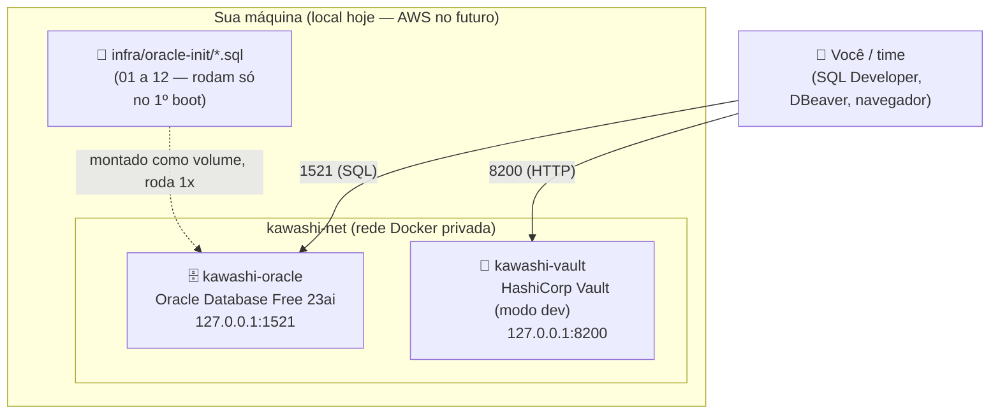
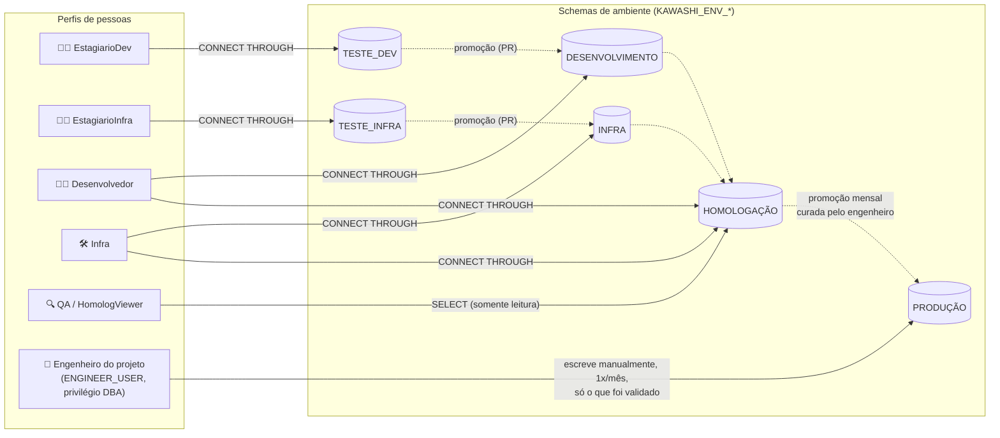
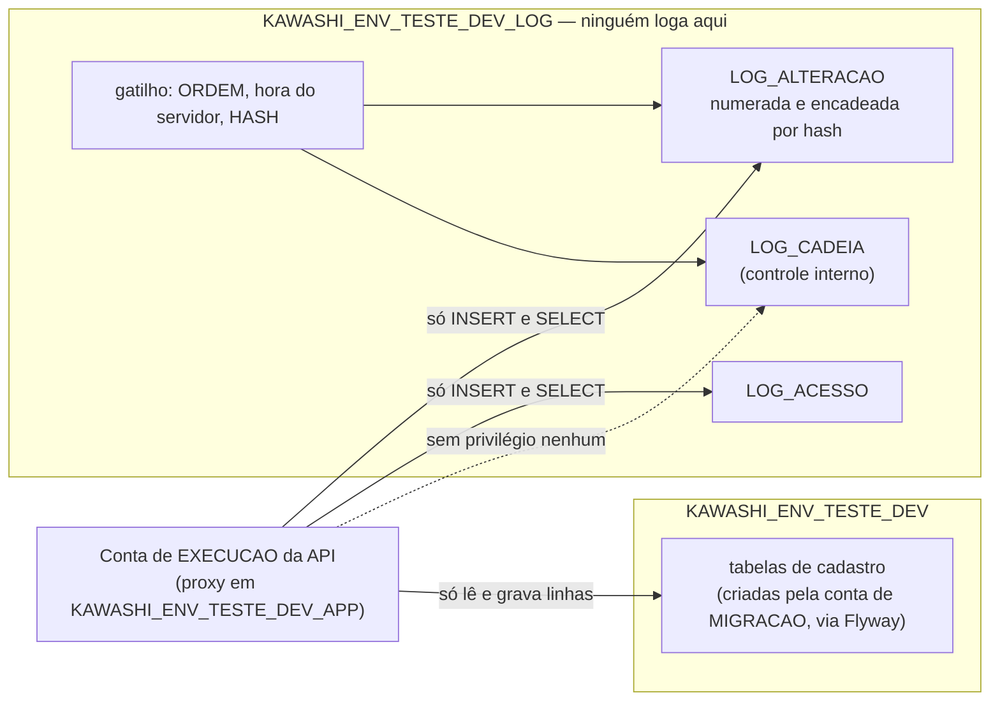
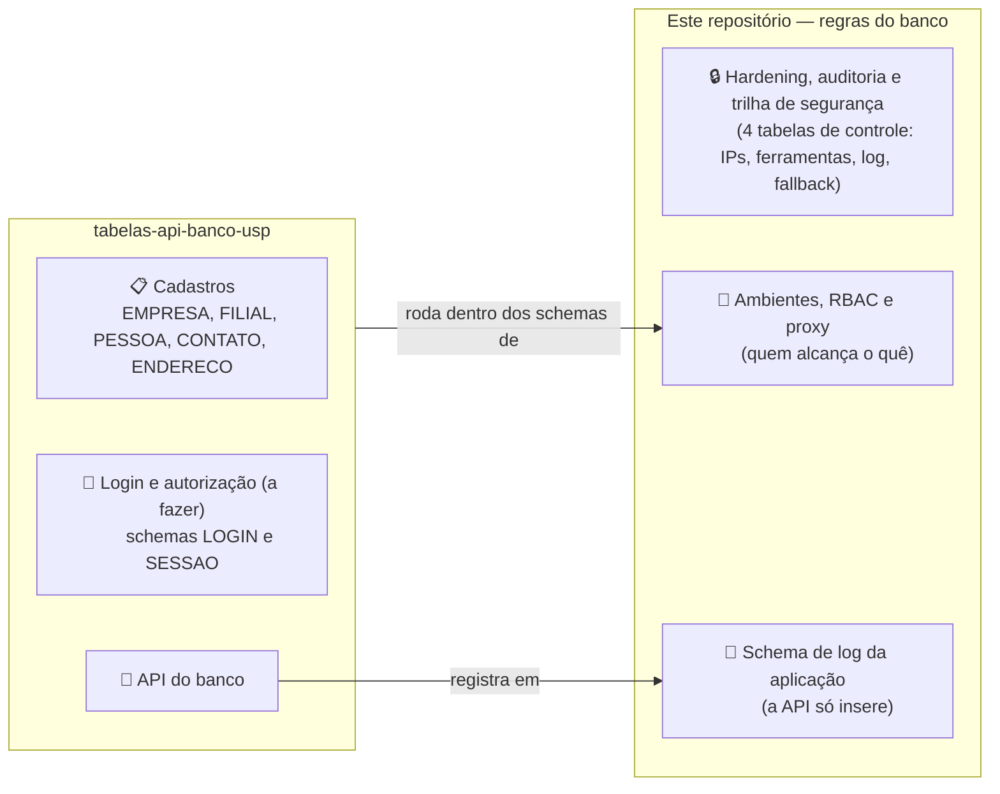
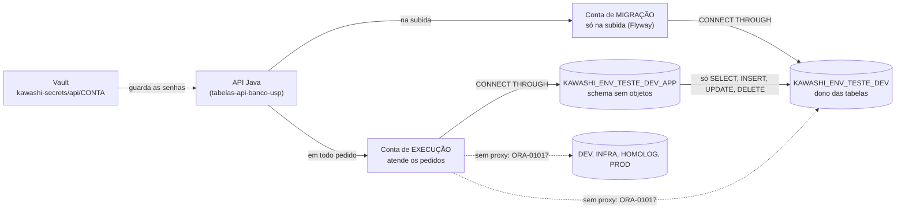
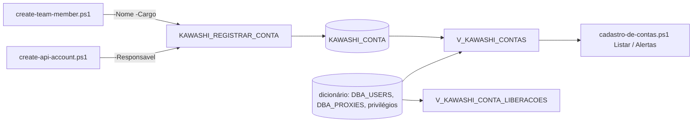
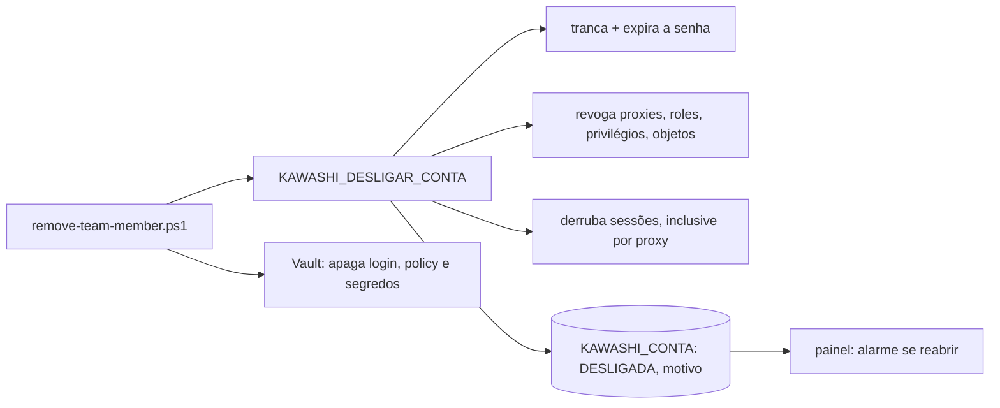
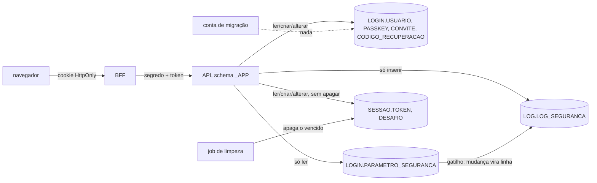
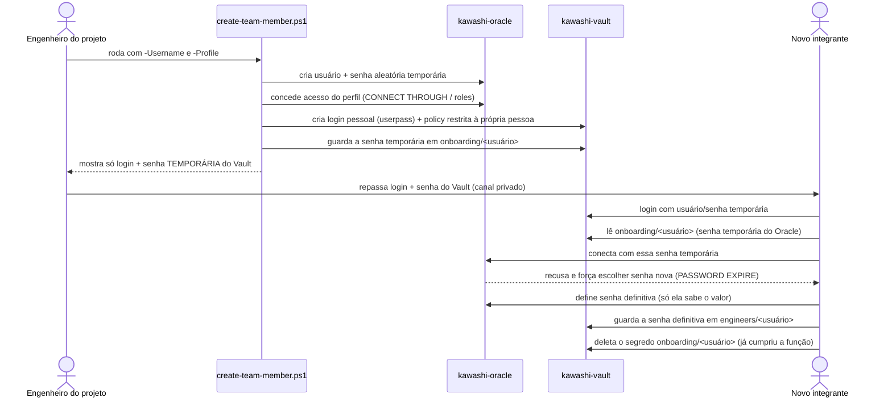

# Arquitetura da Infraestrutura Kawashi

Este documento existe pra dar uma visão de "olho de pássaro" do projeto — como as peças se
conectam — sem precisar ler todos os scripts. Cada diagrama vem acompanhado de uma explicação
do que ele mostra e por quê está desenhado assim.

## 1. Containers e rede

O ambiente local roda dois containers Docker, isolados numa rede privada, cada um exposto
numa porta **só desta máquina** (`127.0.0.1`), nunca para a rede:

**O que prestar atenção aqui:**
- Os dois containers só se enxergam um ao outro pelo nome (`kawashi-oracle`, `kawashi-vault`)
  porque estão na mesma rede Docker (`kawashi-net`) — é assim que uma futura aplicação Spring
  Boot rodando num terceiro container conseguiria alcançar o banco sem saber IP nenhum.
- **Portas só na máquina local.** O `docker-compose.yml` publica `127.0.0.1:1521` e
  `127.0.0.1:8200`. Sem o IP na frente, o Docker publica em todas as interfaces, e qualquer um no
  mesmo Wi-Fi alcança o Oracle e o Vault (este em HTTP puro e aceitando o token root, no modo dev).
  Quem precisa acessar de outra máquina vem por VPN ou túnel SSH, não pela rede aberta. A
  `rotina-diaria.ps1` confere o container **ao vivo** todo dia e acusa porta exposta.
- **A conexão com o banco é cifrada.** O servidor exige AES-256 e conferência SHA-256 em toda
  conexão pela rede, e o listener não aceita ser reconfigurado em tempo de execução
  ([`hardening-rede.md`](hardening-rede.md)). A API e o `sqlplus` negociam sozinhos.
- **O Oracle não tem volume de dados.** O banco inteiro (ambientes, contas, cadastro, a chave do
  TDE) mora dentro do próprio container. `docker stop`/`start`/`restart` preservam tudo;
  **`docker compose down`, ou recriar o container (o que acontece ao mudar a porta ou a imagem),
  apaga o banco**, e os scripts de `oracle-init` rodam de novo num banco vazio (a chave do TDE e
  as contas criadas depois se perdem). Por isso a troca da porta para `127.0.0.1` está no arquivo,
  mas o container que já existia continua publicando para a rede até ser recriado, de forma
  planejada (item 26 de [`bugs-primeiro-teste.md`](bugs-primeiro-teste.md)).
- Os scripts de `oracle-init` só rodam **uma única vez**, no primeiro boot de um container novo.
  Depois disso, mudar um arquivo `.sql` ali não faz efeito sozinho: ele precisa ser aplicado à mão
  no banco que já existe (como foi feito com o `12`) ou o container precisa ser recriado.
- O Vault roda em **modo dev** (memória, sem persistência) — por isso o `vault-init.ps1`
  precisa rodar de novo toda vez que o container é recriado (ver
  [`infra/oracle-init/09_environments.sql`](../oracle-init/09_environments.sql) e o README
  para o que muda quando isso for para produção/AWS).

## 2. Ambientes de ciclo de vida (schemas) e quem acessa o quê

Cada perfil de pessoa só alcança os ambientes liberados pra ele, via *proxy authentication*
(a pessoa loga com o próprio usuário, mas "atua como" o schema do ambiente). Produção só é
alcançada manualmente, pelo engenheiro do projeto. O antigo ambiente único "TESTE" virou dois -
um por equipe (`TESTE_DEV`/`TESTE_INFRA`) - espelhando a separação que já existia entre
`DEV`/`INFRA`:

**O que prestar atenção aqui:**
- **Ninguém** chega em Produção por acesso direto — nem Desenvolvedor, nem Infra. Só o
  `ENGINEER_USER` (privilégio `DBA`) escreve lá, manualmente, uma vez por mês.
- As setas pontilhadas (`Teste_Dev → Dev`, `Teste_Infra → Infra`, `Dev/Infra → Homologação`,
  `Homologação → Produção`) são o **ciclo de vida** de uma tabela/mudança, não um mecanismo
  automático do banco — nenhuma delas copia nada sozinha entre schemas. `Teste_* → Dev/Infra`
  acontece por commit + pull request revisado pelo supervisor; o resto, por quem já tem acesso
  aos dois ambientes decidir promover manualmente. Sem essas setas o desenho dava a entender,
  por engano, que Teste é um ambiente isolado e solto - ele existe justamente para alimentar
  Dev/Infra.
- Nenhum Estagiário (Dev ou Infra) tem **proxy** chegando em Desenvolvimento, Infra ou
  Homologação - só a seta pontilhada de promoção acima, que é trabalho humano (Git), não acesso
  de banco.
- QA/HomologViewer é o único perfil que **não usa proxy** — ele lê Homologação através de uma
  role de `SELECT`, porque não deveria ter poder de escrita/DDL ali (proxy daria isso de
  brinde, então evitamos).
- Isso é isolamento **lógico** (schemas diferentes), não físico — todos os 6 ambientes ainda
  rodam dentro do mesmo container/instância Oracle. Ver Technical Debts no README.

## 2.1 Schema de log da aplicação, um por ambiente

Além do schema do ambiente, cada um dos 6 ambientes tem um schema `KAWASHI_ENV_<AMBIENTE>_LOG`, criado
em [`11_schema_log.sql`](../oracle-init/11_schema_log.sql), com os logs da API. O exemplo usa
TESTE_DEV:

**O que prestar atenção aqui:**
- **Por que estas tabelas são criadas aqui**, e não pelo repositório da API como todas as outras
  de negócio: quem é dono de uma tabela consegue alterar e apagar as linhas dela. A API entra no
  banco como o schema do ambiente; se ela criasse as tabelas de log, seria dona delas. Com o dono
  sendo o schema `_LOG` (`NO AUTHENTICATION`, sem `CREATE SESSION`, sem proxy), "a API só insere" é
  uma permissão do banco, não uma promessa do código.
- **Quem insere não escolhe a numeração, a hora nem o hash.** Um gatilho, que roda como o dono,
  numera cada linha de `LOG_ALTERACAO` sem buraco, carimba a hora do servidor e grava
  `HASH = SHA-256(hash da linha anterior + conteúdo desta)`.
- **A conferência é uma view**, `V_LOG_ALTERACAO_QUEBRAS`: vazia quando a corrente está inteira; uma
  linha por problema quando alguém alterou o conteúdo, apagou uma linha do meio ou apagou as últimas.
- **Quem tem `DBA` conseguiria recalcular a corrente inteira** e enganar a view. Por isso existe a
  **âncora**: `scripts/ancorar-log.ps1` guarda no Vault o número e o hash da última linha, e a
  conferência compara o banco com o Vault (testado em `Test-AncoraDoLog.ps1`, que faz esse ataque
  de verdade). No desenvolvimento o Vault usa a mesma credencial do DBA; em produção a âncora precisa
  ficar fora do alcance de quem administra o banco.
- **Custo:** o gatilho trava a linha de controle até o fim da transação de quem insere, então as
  gravações de log de um mesmo ambiente acontecem uma de cada vez.
- Tudo isso é testado em
  [`Test-SchemaLogSomenteInsercao.ps1`](../tests/caixa-preta/Test-SchemaLogSomenteInsercao.ps1),
  entrando como uma conta de API de verdade e, depois, adulterando como DBA.

Os schemas de serviço de exemplo que existiam aqui (`SEFAZ`, `SIMPLES_NACIONAL`, com a fixture
`CLIENTE` + `CONFIGURACAO_FISCAL` e o parâmetro `-Servicos`) foram **removidos**: eram só material
de teste. Ver item 22 de [`bugs-primeiro-teste.md`](bugs-primeiro-teste.md).

## 2.2 Regras neste repositório, tabelas em outro

Este repositório guarda as **regras** do banco: hardening, ambientes, RBAC, auditoria,
onboarding, Vault e a suíte de testes. As **tabelas de negócio** e a API do banco vivem no
repositório `tabelas-api-banco-usp`. Motivo: ciclos de vida diferentes (regra muda pouco e com
revisão pesada; tabela muda toda semana) e donos diferentes (Infra/SecOps é dono da regra, Dev é
dono da tabela).

**O que prestar atenção aqui:**
- Só duas coisas com tabela ficam aqui: as **4 tabelas de controle** de segurança
  (`KAWASHI_ALLOWED_IPS`, `KAWASHI_FORBIDDEN_TOOLS`, `KAWASHI_SECURITY_LOG` e o fallback, em
  `03`) e as **tabelas de log da aplicação** do `11` (seção 2.1).
- Criar uma conta de banco (pessoa ou API) **não depende de nenhuma tabela de negócio**: a
  identidade vive no dicionário do Oracle (`DBA_USERS`, `DBA_PROXIES`) e a senha no Vault. As
  únicas tabelas tocadas no caminho são as 4 de controle de segurança: os triggers de auditoria
  gravam em `KAWASHI_SECURITY_LOG` e o de logon lê `KAWASHI_ALLOWED_IPS`/`KAWASHI_FORBIDDEN_TOOLS`.
  O `USUARIO` do repositório de tabelas será o usuário do **site** — outro conceito, que nunca é
  uma conta de banco.
- **Dois logs diferentes, de propósito.** `KAWASHI_SECURITY_LOG` é a trilha do **banco** (quem
  conectou, quem criou tabela, quem recebeu privilégio). `LOG_ALTERACAO`/`LOG_ACESSO` são os logs
  da **aplicação** (qual cadastro mudou, qual chamada a API recebeu).
- **Nada se perdeu.** A tag git `dominio-completo-pre-separacao` (commit `cadb773`) guarda o
  repositório inteiro como estava antes da separação. Para ler qualquer arquivo de lá:
  `git show dominio-completo-pre-separacao:infra/oracle-init/12_exemplo_dominio_kawashi_core.sql`.
- **Em aberto** (ver Technical Debts no README): os schemas `LOGIN` e `SESSAO` da próxima etapa da
  API, que também serão criados aqui, com as permissões descritas em
  `tabelas-api-banco-usp/docs/modelo-de-dados.md`.

## 2.3 A API entra pelo mesmo caminho das pessoas

A aplicação não usa uma conta solta: ela entra num ambiente por *proxy authentication*, igual a um
desenvolvedor, só que com o perfil de serviço. A conta é criada por
[`create-api-account.ps1`](../scripts/create-api-account.ps1).

**O que prestar atenção aqui:**
- Perfil de serviço, não de pessoa: o pool JDBC abre mais de 3 conexões e a conta não pode expirar
  a senha sozinha (itens 14 e 4 de [`bugs-primeiro-teste.md`](bugs-primeiro-teste.md)).
- A conta tem só `CREATE SESSION` e nenhum objeto próprio. Tudo o que a API cria ou lê pertence ao
  schema do ambiente. Se a credencial vazar, ela só alcança o ambiente em que foi liberada.
- Produção fica de fora, igual às pessoas.
- **São duas contas por ambiente** (item 23). A de **execução** entra em `KAWASHI_ENV_<AMBIENTE>_APP`,
  um schema sem objetos: só lê e grava linhas nas tabelas e insere no log; não cria, altera nem
  apaga tabela. A de **migração** entra no schema do ambiente, como dona, e só é usada na subida da
  aplicação. Quem invadir a API herda a de execução.
- **Troca da senha sem derrubar a API** (`rotate-api-password.ps1`). O perfil de serviço tem
  `PASSWORD_ROLLOVER_TIME` de 1 dia: depois de uma troca, a senha antiga e a nova valem juntas até a
  API ser reiniciada e a antiga ser encerrada. O script troca no Oracle, no Vault e na linha certa
  do `.env`, sem mostrar a senha. A cobrança dos 90 dias vem do painel de contas.
- O usuário JDBC é `CONTA[KAWASHI_ENV_<AMBIENTE>]`. O driver da Oracle aceita essa sintaxe sem
  código especial, e isso foi verificado ao vivo (item 21).

## 2.4 Cadastro de contas e criptografia em disco

**Cadastro de contas** (`12_cadastro_de_contas.sql`). O Oracle sabe que a conta existe, mas não quem
ela é. `SYS.KAWASHI_CONTA` guarda só isso (tipo, perfil, nome, cargo, ambiente da API), gravado pelos
scripts de criação através da procedure `KAWASHI_REGISTRAR_CONTA`, que só o engenheiro executa.
Liberações e datas de senha **não** são copiadas: as visões `V_KAWASHI_CONTAS` e
`V_KAWASHI_CONTA_LIBERACOES` leem `DBA_USERS`, `DBA_PROXIES`, `DBA_ROLE_PRIVS`, `DBA_SYS_PRIVS` e
`DBA_TAB_PRIVS` na hora. A regra da senha (limite = `PASSWORD_LIFE_TIME` do `KAWASHI_SECURE_PROFILE`)
mora numa função, `KAWASHI_SITUACAO_DA_SENHA`, testada nas fronteiras sem esperar 90 dias. Só a role
`ROLE_KAWASHI_INFRA` lê o painel. A tabela fica em `TS_KAWASHI_DATA`, que é cifrada.

**Criptografia em disco** (`scripts/enable-tde.ps1`). Keystore em arquivo em
`/opt/oracle/admin/FREE/wallet/tde` (pasta 700, arquivo 600), com abertura automática para o banco
subir sozinho; chave mestra para a raiz e os PDBs; AES-256 em todas as `TS_KAWASHI_*` e na `USERS`;
`ENCRYPT_NEW_TABLESPACES=ALWAYS`. A senha do keystore fica no `infra/.env` e no Vault. `SYSTEM`,
`SYSAUX`, `UNDOTBS1` e `TEMP` continuam sem cifra (o controle positivo do teste usa a `SYSAUX`);
nenhuma tabela do Kawashi mora nelas, e o teste confirma que a marca gravada num ambiente não aparece
nem no undo nem no redo.

**Desligamento** (`scripts/remove-team-member.ps1` + procedure `KAWASHI_DESLIGAR_CONTA`). Quem sai
do time perde tudo de uma vez: a conta é trancada com a senha expirada, os proxies em todos os
ambientes, as roles, os privilégios e as permissões em objetos são revogados, as sessões abertas
caem e o Vault apaga o login, a policy e os segredos da pessoa. A sessão aberta **por proxy** é o
detalhe difícil: o Oracle a mostra com o nome do ambiente, não da pessoa, e o número de sessão da
auditoria não é o `AUDSID` do `v$session`. O que liga as duas é o processo do servidor: a auditoria
de logon grava o `OS_PROCESS`, e o `v$process` diz qual processo atende cada sessão. A conta não é
apagada por padrão (fica trancada, para a auditoria continuar ligada a um nome que existe); o
cadastro passa a `DESLIGADA`, com data, quem desligou e o motivo, e o painel acusa como alarme se a
conta for destrancada ou receber acesso de novo. Conta de API, administrador e quem tem `DBA` são
recusados.

**Rotina diária** (`scripts/rotina-diaria.ps1`, agendada por `scripts/agendar-rotina.ps1` no
Agendador de Tarefas do Windows, todo dia às 9h). Junta o que antes dependia de alguém lembrar:
confere se Docker, banco e Vault estão no ar, se as portas estão só na máquina local, se o Vault foi
reiniciado (e o reconfigura), as pendências das contas (`cadastro-de-contas.ps1 -Acao Alertas`) e o
log de alterações de cada ambiente (`ancorar-log.ps1`, que confere e só então avança a âncora).
Grava o relatório em `infra/logs/` (fora do git) e, se algo precisa de atenção, mostra um aviso na
área de notificação. Roda só com o usuário logado, sem senha guardada no Windows; se o computador
estiver desligado no horário, roda quando ele voltar.

**Limite honesto.** O keystore de abertura automática fica no mesmo container que os dados: protege
contra quem leva só os arquivos de dados ou um backup, não contra quem leva o container inteiro. Em
produção o keystore vai para um cofre externo (HSM ou o KMS da nuvem).

## 2.5 Login da aplicação: LOGIN, SESSAO e os logs de segurança

O login da API é **só por passkey** (WebAuthn): não existe senha de usuário. `13_schema_login.sql`
cria, por ambiente, dois schemas donos de si mesmos (ninguém loga neles) e duas tabelas no schema de
log. A API (schema `_APP`) recebe só o que precisa:

| Onde | Tabela | A API pode |
|---|---|---|
| `_LOGIN` | `USUARIO`, `PASSKEY`, `CONVITE`, `CODIGO_RECUPERACAO` | ler, criar, alterar |
| `_LOGIN` | `PARAMETRO_SEGURANCA` | **só ler** (mudança no banco vai sozinha para o `LOG_SEGURANCA`) |
| `_SESSAO` | `TOKEN`, `DESAFIO`, `BLOQUEIO_IP` | ler, criar, alterar (**não apaga**: quem apaga o vencido é o job `KAWASHI_LIMPEZA_SESSAO_JOB`, todo dia às 3h30) |
| `_LOG` | `TENTATIVA_LOGIN`, `LOG_SEGURANCA` | só inserir e ler |

Nenhum `DELETE`. Do banco não sai nada que sirva para entrar: das passkeys só há a chave **pública**;
de token, convite e código de recuperação, só o SHA-256. A conta de **migração** da API não recebe
nada: não enxerga nem os e-mails nem as chaves. A chave `USUARIO.PESSOA_ID → PESSOA` cruza schemas e
só pode existir depois que a migração da API cria a `PESSOA`: por isso quem a liga é a procedure
`SYS.KAWASHI_LIGAR_LOGIN_PESSOA`, chamada pelo `afterMigrate.sql` da API e executável só pelos schemas
de ambiente (nem o DBA a enxerga).

Fora do banco, a API só atende o **BFF** (repositório `bff-banco-usp`, o servidor do site): todo
pedido leva um segredo compartilhado, e o token fica guardado no BFF, nunca no navegador. Ver
`tabelas-api-banco-usp/docs/api-e-regras.md`, "Login".

**Hora em UTC.** As colunas de hora são `TIMESTAMP` sem fuso, gravadas e comparadas com
`SYS_EXTRACT_UTC(SYSTIMESTAMP)`. Comparar com `SYSTIMESTAMP` faz o Oracle ler a coluna no fuso da
sessão de quem consulta; com a API em −05:00, um token vencido valia mais 5 horas (achado 31).

## 3. Como uma pessoa nova recebe acesso (onboarding via Vault)

Nenhuma senha passa por chat, e-mail ou arquivo de texto em nenhum momento deste fluxo:

**O que prestar atenção aqui:**
- O admin nunca vê a senha definitiva do Oracle — só a temporária, que expira no primeiro uso.
- A senha definitiva nunca "passa" pelo Vault de forma automática — o próprio Oracle não avisa
  ninguém quando alguém troca a própria senha, então guardar ela de volta no cofre é uma ação
  manual e voluntária da pessoa (Passo 4 do
  [guia de onboarding](onboarding-novo-membro.md)).
- Cada pessoa só enxerga seu próprio espaço no Vault (`onboarding/<usuário>` e
  `engineers/<usuário>`) — a policy criada pelo script restringe isso.

## Documentos relacionados

- [`resumo-visual.html`](resumo-visual.html) — resumo de uma página do repositório inteiro (abrir no
  navegador).
- [`criar-novo-usuario.md`](criar-novo-usuario.md) — guia do administrador para criar acesso
  (inclui a conta da API).
- [`onboarding-novo-membro.md`](onboarding-novo-membro.md) — guia de quem está recebendo acesso.
- [`../oracle-init/09_environments.sql`](../oracle-init/09_environments.sql) — implementação
  dos ambientes/schemas e o racional completo de cada decisão.
- [`../oracle-init/11_schema_log.sql`](../oracle-init/11_schema_log.sql) — schema de log da
  aplicação por ambiente: tabelas, gatilho de encadeamento, view de conferência e permissões.
- [`../../README.md`](../../README.md) — visão geral do projeto e roadmap.
