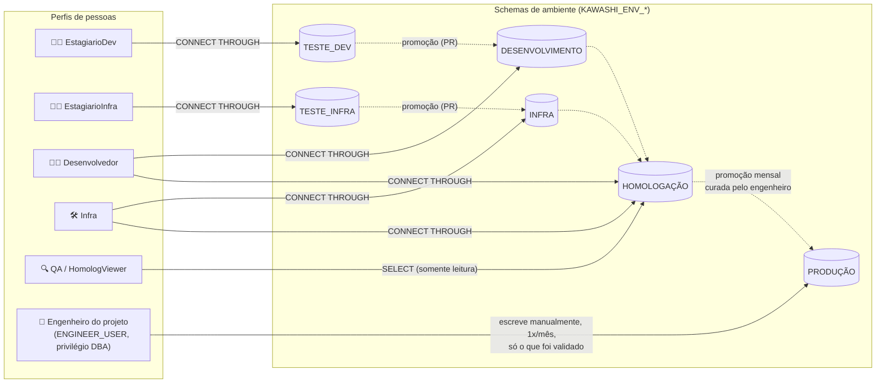
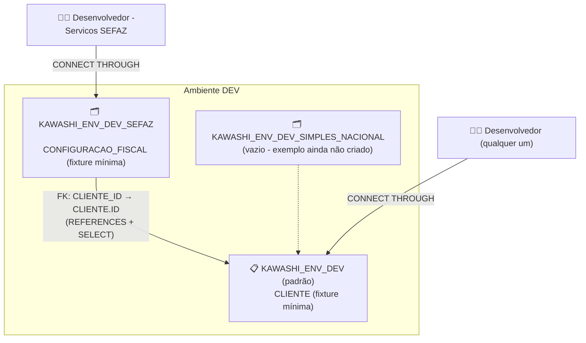
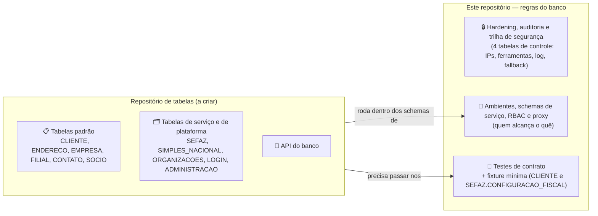
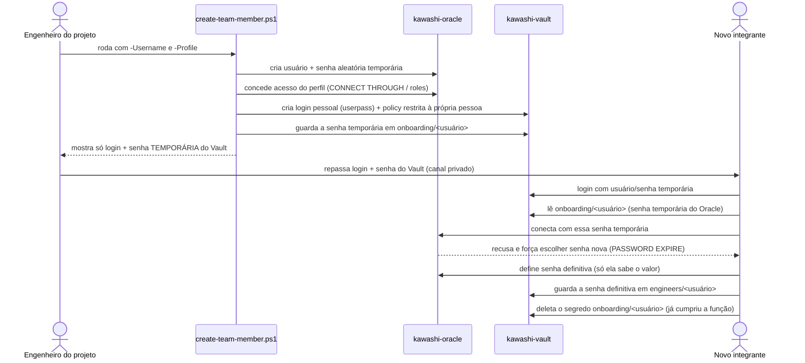

# Arquitetura da Infraestrutura Kawashi

Este documento existe pra dar uma visão de "olho de pássaro" do projeto — como as peças se
conectam — sem precisar ler todos os scripts. Cada diagrama vem acompanhado de uma explicação
do que ele mostra e por quê está desenhado assim.

## 1. Containers e rede

O ambiente local roda dois containers Docker, isolados numa rede privada, cada um exposto
numa porta do seu computador:

**O que prestar atenção aqui:**
- Os dois containers só se enxergam um ao outro pelo nome (`kawashi-oracle`, `kawashi-vault`)
  porque estão na mesma rede Docker (`kawashi-net`) — é assim que uma futura aplicação Spring
  Boot rodando num terceiro container conseguiria alcançar o banco sem saber IP nenhum.
- Os scripts de `oracle-init` só rodam **uma única vez**, no primeiro boot do container
  (quando o volume de dados do Oracle ainda não existe). Depois disso, mudar um arquivo `.sql`
  ali não faz efeito sozinho — precisa recriar o container do zero.
- O Vault roda em **modo dev** (memória, sem persistência) — por isso o `vault-init.ps1`
  precisa rodar de novo toda vez que o container é recriado (ver
  [`infra/oracle-init/09_environments.sql`](../oracle-init/09_environments.sql) e o README
  para o que muda quando isso for para produção/AWS).

## 2. Ambientes de ciclo de vida (schemas) e quem acessa o quê

Cada perfil de pessoa só alcança os ambientes liberados pra ele, via *proxy authentication*
(a pessoa loga com o próprio usuário, mas "atua como" o schema do ambiente). Produção só é
alcançada manualmente, pelo engenheiro do projeto. O antigo ambiente único "TESTE" virou dois -
um por equipe (`TESTE_DEV`/`TESTE_INFRA`) - espelhando a separação que já existia entre
`DEV`/`INFRA`:

**O que prestar atenção aqui:**
- **Ninguém** chega em Produção por acesso direto — nem Desenvolvedor, nem Infra. Só o
  `ENGINEER_USER` (privilégio `DBA`) escreve lá, manualmente, uma vez por mês.
- As setas pontilhadas (`Teste_Dev → Dev`, `Teste_Infra → Infra`, `Dev/Infra → Homologação`,
  `Homologação → Produção`) são o **ciclo de vida** de uma tabela/mudança, não um mecanismo
  automático do banco — nenhuma delas copia nada sozinha entre schemas. `Teste_* → Dev/Infra`
  acontece por commit + pull request revisado pelo supervisor; o resto, por quem já tem acesso
  aos dois ambientes decidir promover manualmente. Sem essas setas o desenho dava a entender,
  por engano, que Teste é um ambiente isolado e solto - ele existe justamente para alimentar
  Dev/Infra.
- Nenhum Estagiário (Dev ou Infra) tem **proxy** chegando em Desenvolvimento, Infra ou
  Homologação - só a seta pontilhada de promoção acima, que é trabalho humano (Git), não acesso
  de banco.
- QA/HomologViewer é o único perfil que **não usa proxy** — ele lê Homologação através de uma
  role de `SELECT`, porque não deveria ter poder de escrita/DDL ali (proxy daria isso de
  brinde, então evitamos).
- Isso é isolamento **lógico** (schemas diferentes), não físico — todos os 6 ambientes ainda
  rodam dentro do mesmo container/instância Oracle. Ver Technical Debts no README.

## 2.1 Segmentação por serviço DENTRO de cada ambiente

Além da divisão por estágio de ciclo de vida, cada ambiente acima tem uma segunda camada: tabelas
**padrão** (compartilhadas, ex: `CLIENTE`) e schemas de **serviço** (ex: `SEFAZ`,
`SIMPLES_NACIONAL`) com tabelas específicas que referenciam o padrão via FK, mas só são visíveis
a quem tem liberação explícita pra aquele serviço (parâmetro `-Servicos` do onboarding, aditivo e
independente do perfil). O exemplo abaixo usa o ambiente DEV, mas o mesmo desenho existe em cada
um dos 6 ambientes:

**O que prestar atenção aqui:**
- A FK é **só de ida**: o schema de serviço referencia o padrão (`SEFAZ.CONFIGURACAO_FISCAL.CLIENTE_ID
  → KAWASHI_ENV_DEV.CLIENTE.ID`) - o padrão nunca sabe que SEFAZ existe, nem referencia nada nele.
  Isso é o que mantém o padrão reutilizável por qualquer serviço novo sem precisar mudar nada nele.
- `REFERENCES` sozinho só permite **criar** a FK - não dá privilégio de leitura nenhum (achado
  real, ver item 17 de [`bugs-primeiro-teste.md`](bugs-primeiro-teste.md)). Por isso o schema de
  serviço também recebe `GRANT SELECT` em todas as tabelas padrão do ambiente.
- Ter `-Servicos SEFAZ` não dá acesso a `SIMPLES_NACIONAL` de brinde - a liberação é estritamente
  por serviço, nunca "tudo ou nada".
- Fora do escopo por enquanto (ver `bugs-primeiro-teste.md`): sincronizar automaticamente a
  estrutura de uma tabela de serviço entre ambientes conforme ela é promovida (TESTE_DEV → DEV →
  HOMOLOG → PROD) - por isso as tabelas de exemplo hoje só existem em `TESTE_DEV`/`DEV`, não nos
  outros 4 ambientes (que já têm os schemas de serviço criados, vazios, prontos pra isso).

## 2.2 Regras neste repositório, tabelas em outro

Este repositório guarda as **regras** do banco: hardening, ambientes, RBAC, auditoria,
onboarding, Vault e a suíte de testes. As **tabelas de negócio** (endereço, empresa, filial,
contato, sócio, e os schemas de plataforma como organizações/login/administração) e a API do
banco vão viver em um repositório separado, ainda a ser criado. Motivo: ciclos de vida
diferentes (regra muda pouco e com revisão pesada; tabela muda toda semana) e donos diferentes
(Infra/SecOps é dono da regra, Dev é dono da tabela).

**O que prestar atenção aqui:**
- Só duas coisas com tabela ficam aqui: as **4 tabelas de controle** de segurança
  (`KAWASHI_ALLOWED_IPS`, `KAWASHI_FORBIDDEN_TOOLS`, `KAWASHI_SECURITY_LOG` e o fallback, em
  `03`) e a **fixture mínima** do `11` (`CLIENTE` + `SEFAZ.CONFIGURACAO_FISCAL`, só em
  `TESTE_DEV`/`DEV`), que existe pra os testes terem o que exercitar.
- Criar uma conta de banco (pessoa ou API) **não depende de nenhuma tabela de negócio**: a
  identidade vive no dicionário do Oracle (`DBA_USERS`, `DBA_PROXIES`) e a senha no Vault. As
  únicas tabelas tocadas no caminho são as 4 de controle de segurança: os triggers de auditoria
  gravam em `KAWASHI_SECURITY_LOG` e o de logon lê `KAWASHI_ALLOWED_IPS`/`KAWASHI_FORBIDDEN_TOOLS`.
  `LOGIN.USUARIO`, no
  repositório de tabelas, será o usuário do **site** (cliente da Kawashi) — outro conceito, que
  nunca é uma conta de banco.
- O invariante "padrão nunca referencia serviço" (seção 2.1) é um **contrato**: o teste mora
  aqui e o repositório de tabelas precisa passar nele.
- **Nada se perdeu.** A tag git `dominio-completo-pre-separacao` (commit `cadb773`) guarda o
  repositório inteiro
  como estava antes da separação — os dois SQL de domínio originais, o teste de invariante com
  5 casos, as seções 2.1/2.2 deste documento com os diagramas de `ORGANIZACOES`/`LOGIN`/
  `ADMINISTRACAO`. Para ler qualquer arquivo de lá:
  `git show dominio-completo-pre-separacao:infra/oracle-init/12_exemplo_dominio_kawashi_core.sql`.
- **Em aberto** (ver Technical Debts no README): como o repositório de tabelas é aplicado sobre
  este (regras sobem primeiro, tabelas depois), e onde mora a regra de "serviço lê todas as
  tabelas padrão", que hoje roda uma vez só no primeiro boot.

## 3. Como uma pessoa nova recebe acesso (onboarding via Vault)

Nenhuma senha passa por chat, e-mail ou arquivo de texto em nenhum momento deste fluxo:

**O que prestar atenção aqui:**
- O admin nunca vê a senha definitiva do Oracle — só a temporária, que expira no primeiro uso.
- A senha definitiva nunca "passa" pelo Vault de forma automática — o próprio Oracle não avisa
  ninguém quando alguém troca a própria senha, então guardar ela de volta no cofre é uma ação
  manual e voluntária da pessoa (Passo 4 do
  [guia de onboarding](onboarding-novo-membro.md)).
- Cada pessoa só enxerga seu próprio espaço no Vault (`onboarding/<usuário>` e
  `engineers/<usuário>`) — a policy criada pelo script restringe isso.

## Documentos relacionados

- [`criar-novo-usuario.md`](criar-novo-usuario.md) — guia do administrador para criar acesso.
- [`onboarding-novo-membro.md`](onboarding-novo-membro.md) — guia de quem está recebendo acesso.
- [`../oracle-init/09_environments.sql`](../oracle-init/09_environments.sql) — implementação
  dos ambientes/schemas e o racional completo de cada decisão.
- [`../oracle-init/11_fixture_contrato_segmentacao.sql`](../oracle-init/11_fixture_contrato_segmentacao.sql)
  — fixture mínima (`CLIENTE` + `SEFAZ.CONFIGURACAO_FISCAL`) pros testes de contrato do padrão
  tabela padrão + schema de serviço. Não é domínio de negócio — ver seção 2.2.
- [`../../README.md`](../../README.md) — visão geral do projeto e roadmap.
