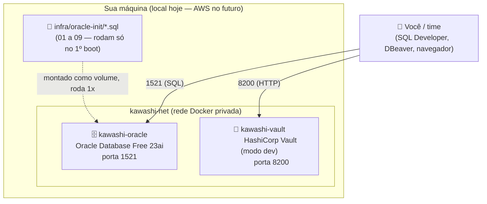
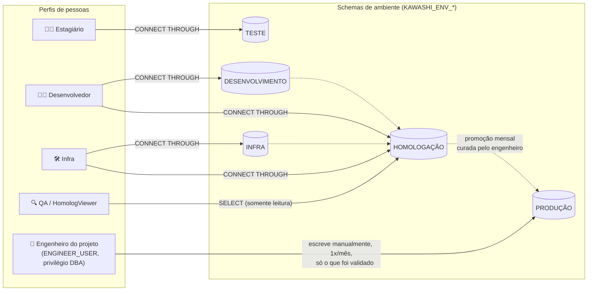
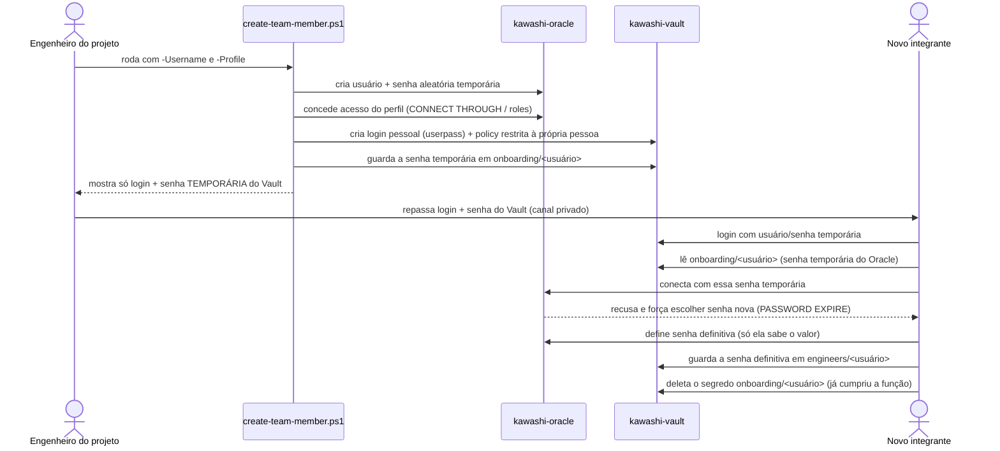

# Arquitetura da Infraestrutura Kawashi

Este documento existe pra dar uma visão de "olho de pássaro" do projeto — como as peças se
conectam — sem precisar ler todos os scripts. Cada diagrama vem acompanhado de uma explicação
do que ele mostra e por quê está desenhado assim.

## 1. Containers e rede

O ambiente local roda dois containers Docker, isolados numa rede privada, cada um exposto
numa porta do seu computador:

**O que prestar atenção aqui:**
- Os dois containers só se enxergam um ao outro pelo nome (`kawashi-oracle`, `kawashi-vault`)
  porque estão na mesma rede Docker (`kawashi-net`) — é assim que uma futura aplicação Spring
  Boot rodando num terceiro container conseguiria alcançar o banco sem saber IP nenhum.
- Os scripts de `oracle-init` só rodam **uma única vez**, no primeiro boot do container
  (quando o volume de dados do Oracle ainda não existe). Depois disso, mudar um arquivo `.sql`
  ali não faz efeito sozinho — precisa recriar o container do zero.
- O Vault roda em **modo dev** (memória, sem persistência) — por isso o `vault-init.ps1`
  precisa rodar de novo toda vez que o container é recriado (ver
  [`infra/oracle-init/09_environments.sql`](../oracle-init/09_environments.sql) e o README
  para o que muda quando isso for para produção/AWS).

## 2. Ambientes de ciclo de vida (schemas) e quem acessa o quê

Cada perfil de pessoa só alcança os ambientes liberados pra ele, via *proxy authentication*
(a pessoa loga com o próprio usuário, mas "atua como" o schema do ambiente). Produção só é
alcançada manualmente, pelo engenheiro do projeto:

**O que prestar atenção aqui:**
- **Ninguém** chega em Produção por acesso direto — nem Desenvolvedor, nem Infra. Só o
  `ENGINEER_USER` (privilégio `DBA`) escreve lá, manualmente, uma vez por mês.
- Estagiário **não** tem nenhuma seta chegando em Homologação — a revisão do trabalho dele
  acontece no Git (pull request), não no banco. Só quem já tem acesso a Desenvolvimento ou
  Infra consegue promover algo pra Homologação.
- QA/HomologViewer é o único perfil que **não usa proxy** — ele lê Homologação através de uma
  role de `SELECT`, porque não deveria ter poder de escrita/DDL ali (proxy daria isso de
  brinde, então evitamos).
- Isso é isolamento **lógico** (schemas diferentes), não físico — todos os 5 ambientes ainda
  rodam dentro do mesmo container/instância Oracle. Ver Technical Debts no README.

## 3. Como uma pessoa nova recebe acesso (onboarding via Vault)

Nenhuma senha passa por chat, e-mail ou arquivo de texto em nenhum momento deste fluxo:

**O que prestar atenção aqui:**
- O admin nunca vê a senha definitiva do Oracle — só a temporária, que expira no primeiro uso.
- A senha definitiva nunca "passa" pelo Vault de forma automática — o próprio Oracle não avisa
  ninguém quando alguém troca a própria senha, então guardar ela de volta no cofre é uma ação
  manual e voluntária da pessoa (Passo 4 do
  [guia de onboarding](onboarding-novo-membro.md)).
- Cada pessoa só enxerga seu próprio espaço no Vault (`onboarding/<usuário>` e
  `engineers/<usuário>`) — a policy criada pelo script restringe isso.

## Documentos relacionados

- [`criar-novo-usuario.md`](criar-novo-usuario.md) — guia do administrador para criar acesso.
- [`onboarding-novo-membro.md`](onboarding-novo-membro.md) — guia de quem está recebendo acesso.
- [`../oracle-init/09_environments.sql`](../oracle-init/09_environments.sql) — implementação
  dos ambientes/schemas e o racional completo de cada decisão.
- [`../../README.md`](../../README.md) — visão geral do projeto e roadmap.
