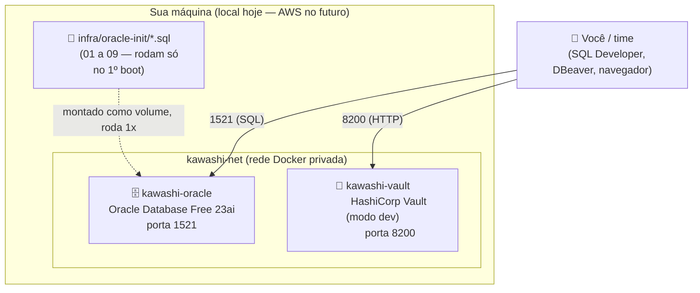
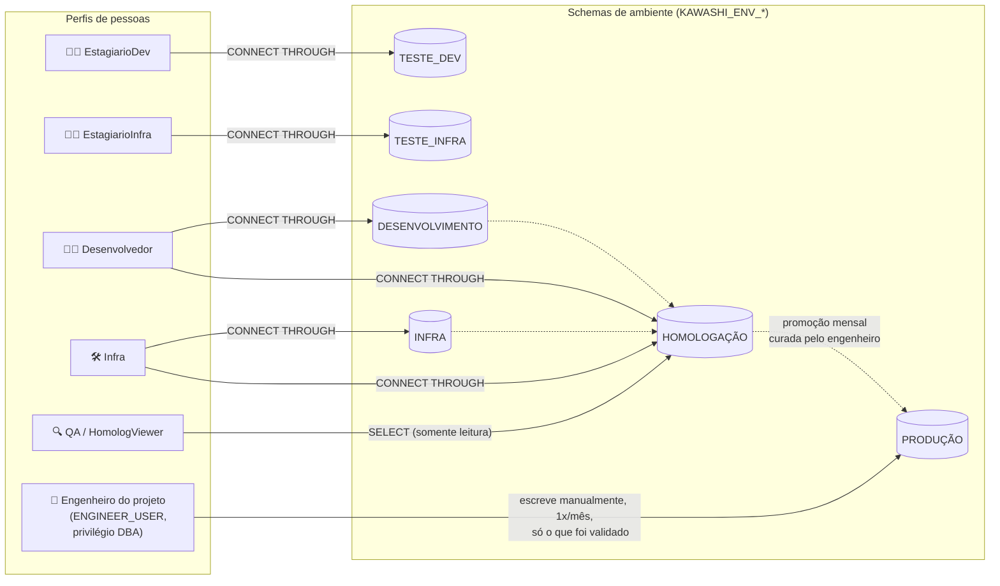
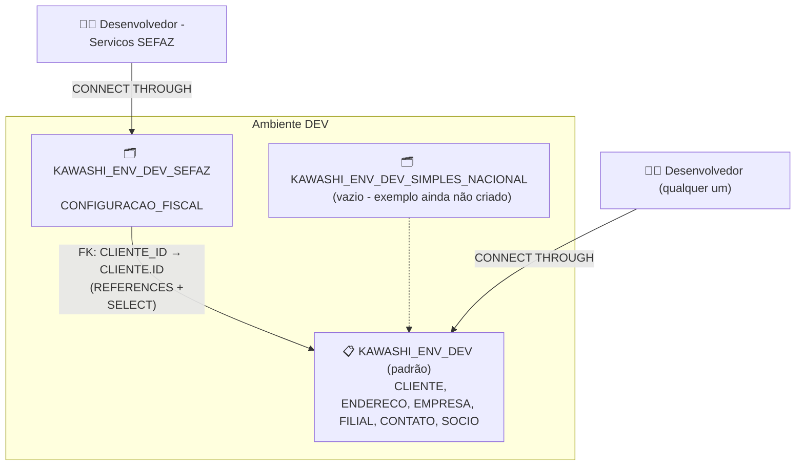
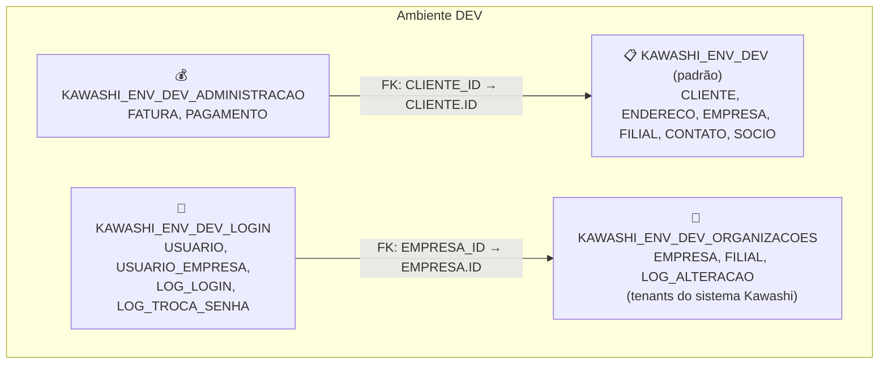
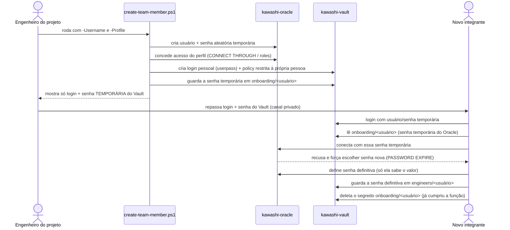

# Arquitetura da Infraestrutura Kawashi

Este documento existe pra dar uma visão de "olho de pássaro" do projeto — como as peças se
conectam — sem precisar ler todos os scripts. Cada diagrama vem acompanhado de uma explicação
do que ele mostra e por quê está desenhado assim.

## 1. Containers e rede

O ambiente local roda dois containers Docker, isolados numa rede privada, cada um exposto
numa porta do seu computador:

**O que prestar atenção aqui:**
- Os dois containers só se enxergam um ao outro pelo nome (`kawashi-oracle`, `kawashi-vault`)
  porque estão na mesma rede Docker (`kawashi-net`) — é assim que uma futura aplicação Spring
  Boot rodando num terceiro container conseguiria alcançar o banco sem saber IP nenhum.
- Os scripts de `oracle-init` só rodam **uma única vez**, no primeiro boot do container
  (quando o volume de dados do Oracle ainda não existe). Depois disso, mudar um arquivo `.sql`
  ali não faz efeito sozinho — precisa recriar o container do zero.
- O Vault roda em **modo dev** (memória, sem persistência) — por isso o `vault-init.ps1`
  precisa rodar de novo toda vez que o container é recriado (ver
  [`infra/oracle-init/09_environments.sql`](../oracle-init/09_environments.sql) e o README
  para o que muda quando isso for para produção/AWS).

## 2. Ambientes de ciclo de vida (schemas) e quem acessa o quê

Cada perfil de pessoa só alcança os ambientes liberados pra ele, via *proxy authentication*
(a pessoa loga com o próprio usuário, mas "atua como" o schema do ambiente). Produção só é
alcançada manualmente, pelo engenheiro do projeto. O antigo ambiente único "TESTE" virou dois -
um por equipe (`TESTE_DEV`/`TESTE_INFRA`) - espelhando a separação que já existia entre
`DEV`/`INFRA`:

**O que prestar atenção aqui:**
- **Ninguém** chega em Produção por acesso direto — nem Desenvolvedor, nem Infra. Só o
  `ENGINEER_USER` (privilégio `DBA`) escreve lá, manualmente, uma vez por mês.
- Nenhum Estagiário (Dev ou Infra) tem seta chegando em Homologação — a revisão do trabalho deles
  acontece no Git (pull request), não no banco. Só quem já tem acesso a Desenvolvimento ou
  Infra consegue promover algo pra Homologação.
- QA/HomologViewer é o único perfil que **não usa proxy** — ele lê Homologação através de uma
  role de `SELECT`, porque não deveria ter poder de escrita/DDL ali (proxy daria isso de
  brinde, então evitamos).
- Isso é isolamento **lógico** (schemas diferentes), não físico — todos os 6 ambientes ainda
  rodam dentro do mesmo container/instância Oracle. Ver Technical Debts no README.

## 2.1 Segmentação por serviço DENTRO de cada ambiente

Além da divisão por estágio de ciclo de vida, cada ambiente acima tem uma segunda camada: tabelas
**padrão** (compartilhadas, ex: `CLIENTE`) e schemas de **serviço** (ex: `SEFAZ`,
`SIMPLES_NACIONAL`) com tabelas específicas que referenciam o padrão via FK, mas só são visíveis
a quem tem liberação explícita pra aquele serviço (parâmetro `-Servicos` do onboarding, aditivo e
independente do perfil). O exemplo abaixo usa o ambiente DEV, mas o mesmo desenho existe em cada
um dos 6 ambientes:

**O que prestar atenção aqui:**
- A FK é **só de ida**: o schema de serviço referencia o padrão (`SEFAZ.CONFIGURACAO_FISCAL.CLIENTE_ID
  → KAWASHI_ENV_DEV.CLIENTE.ID`) - o padrão nunca sabe que SEFAZ existe, nem referencia nada nele.
  Isso é o que mantém o padrão reutilizável por qualquer serviço novo sem precisar mudar nada nele.
- `REFERENCES` sozinho só permite **criar** a FK - não dá privilégio de leitura nenhum (achado
  real, ver item 17 de [`bugs-primeiro-teste.md`](bugs-primeiro-teste.md)). Por isso o schema de
  serviço também recebe `GRANT SELECT` em todas as tabelas padrão do ambiente.
- Ter `-Servicos SEFAZ` não dá acesso a `SIMPLES_NACIONAL` de brinde - a liberação é estritamente
  por serviço, nunca "tudo ou nada".
- Fora do escopo por enquanto (ver `bugs-primeiro-teste.md`): sincronizar automaticamente a
  estrutura de uma tabela de serviço entre ambientes conforme ela é promovida (TESTE_DEV → DEV →
  HOMOLOG → PROD) - por isso as tabelas de exemplo hoje só existem em `TESTE_DEV`/`DEV`, não nos
  outros 4 ambientes (que já têm os schemas de serviço criados, vazios, prontos pra isso).

## 2.2 Mais exemplos ilustrativos do mesmo padrão (ORGANIZACOES, LOGIN, ADMINISTRACAO)

Além de SEFAZ/SIMPLES_NACIONAL, três outros schemas de serviço foram criados só como mais
referência e material de teste do mesmo padrão padrão+serviço — sem aprofundar o desenho de
nenhum deles (decisão explícita: "não vamos nos aprofundar em nenhum esquema, só por eles pra
gente ir usando como exemplos e testes"). Também em `TESTE_DEV`/`DEV` apenas, mesma lógica da
seção 2.1:

**O que prestar atenção aqui:**
- `ORGANIZACOES.EMPRESA` (os *tenants* que usam o sistema Kawashi) **não é a mesma coisa** que
  `EMPRESA` do schema padrão (que representa uma empresa do CLIENTE fiscal, usada por
  SEFAZ/SIMPLES_NACIONAL) — são dois conceitos diferentes, em schemas diferentes, sem nenhuma
  relação entre si. Só compartilham o nome por coincidência de domínio.
- `LOGIN` modela uma pessoa podendo pertencer a mais de uma organização com um papel diferente
  em cada uma (`USUARIO_EMPRESA`, N:N) — ela escolhe com qual organização quer logar depois de
  validar email+senha. `LOG_LOGIN`/`LOG_TROCA_SENHA` guardam só o histórico; a regra em si (2FA,
  forçar troca a cada 3 meses) é lógica de aplicação, fora do escopo de uma tabela de exemplo —
  mesma filosofia do projeto inteiro de nunca guardar segredo de verdade em texto puro no banco.
- `ADMINISTRACAO` referencia o `CLIENTE` do schema padrão — o **mesmo** `CLIENTE` que SEFAZ já
  referencia. Prova concreta de que o padrão é reutilizável por um serviço novo, inclusive um que
  não é fiscal, sem precisar mudar nada nele.
- Nenhum `-Profile`/`-Servicos` de `create-team-member.ps1` concede acesso a estes 3 schemas
  ainda — por enquanto existem só como exemplo e material de teste de arquitetura (ver
  `infra/tests/caixa-branca/Test-InvarianteFkPadraoNuncaReferenciaServico.ps1`, que confirma que
  a FK entre padrão e serviço nunca existe no sentido contrário, em nenhum dos 6 ambientes).

## 3. Como uma pessoa nova recebe acesso (onboarding via Vault)

Nenhuma senha passa por chat, e-mail ou arquivo de texto em nenhum momento deste fluxo:

**O que prestar atenção aqui:**
- O admin nunca vê a senha definitiva do Oracle — só a temporária, que expira no primeiro uso.
- A senha definitiva nunca "passa" pelo Vault de forma automática — o próprio Oracle não avisa
  ninguém quando alguém troca a própria senha, então guardar ela de volta no cofre é uma ação
  manual e voluntária da pessoa (Passo 4 do
  [guia de onboarding](onboarding-novo-membro.md)).
- Cada pessoa só enxerga seu próprio espaço no Vault (`onboarding/<usuário>` e
  `engineers/<usuário>`) — a policy criada pelo script restringe isso.

## Documentos relacionados

- [`criar-novo-usuario.md`](criar-novo-usuario.md) — guia do administrador para criar acesso.
- [`onboarding-novo-membro.md`](onboarding-novo-membro.md) — guia de quem está recebendo acesso.
- [`../oracle-init/09_environments.sql`](../oracle-init/09_environments.sql) — implementação
  dos ambientes/schemas e o racional completo de cada decisão.
- [`../oracle-init/11_exemplo_dominio_negocio.sql`](../oracle-init/11_exemplo_dominio_negocio.sql)
  — exemplo ilustrativo do padrão tabelas padrão + schema de serviço (não é o schema de negócio
  final).
- [`../oracle-init/12_exemplo_dominio_kawashi_core.sql`](../oracle-init/12_exemplo_dominio_kawashi_core.sql)
  — mais exemplos ilustrativos do mesmo padrão (ORGANIZACOES, LOGIN, ADMINISTRACAO — ver seção 2.2).
- [`../../README.md`](../../README.md) — visão geral do projeto e roadmap.
